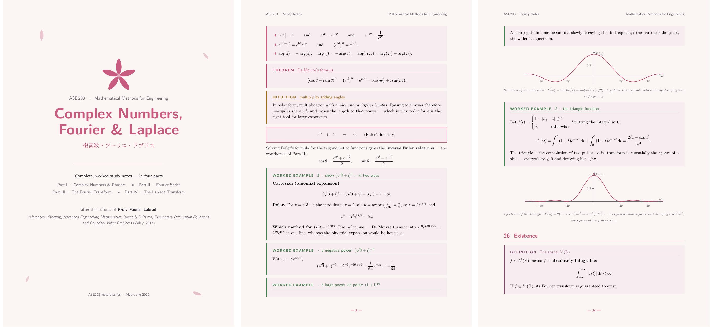
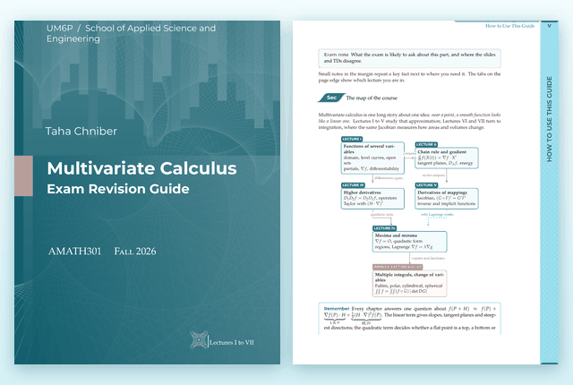
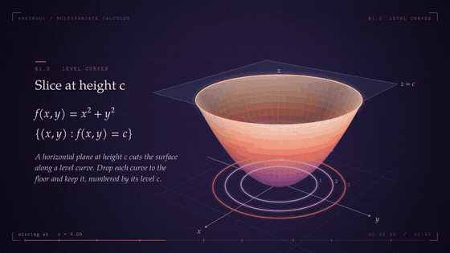
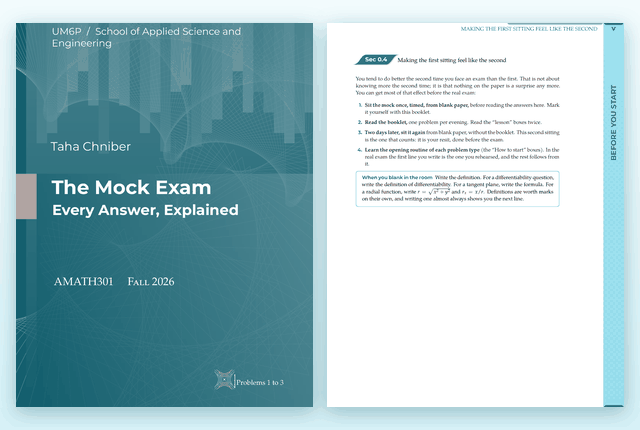

<div align="center">

<picture>
  <source media="(prefers-color-scheme: dark)" srcset="math-courses/assets/repo-banner-dark.svg">
  
</picture>

**[🌸 Sakura Notes](#-sakura-notes-a-washi-paper-latex-theme)** · **[📚 Math courses](#-math-courses)** · **[📁 What's inside](#-whats-in-this-repo)** · **[📄 Licence](#-licence)**


</div>

> I'm **Taha Chniber**, doing a BSc in Applied Mathematics at **SASE, Mohammed VI
> Polytechnic University (UM6P)**. I write my course notes in LaTeX. One set of
> them ended up on Reddit and pulled close to 10k views, and the question I kept
> getting was about the *look*, not the maths. So this repo holds two things: the
> theme I pulled out of those notes, and the course material I've built since.

<table>
<tr>
<td width="50%" valign="top">

### 🌸 Sakura Notes
<a href="#-sakura-notes-a-washi-paper-latex-theme"></a>

A drop-in washi-paper theme for study notes: one `.sty`, light and dark modes, six
colour-coded boxes, TikZ cherry blossoms. The ASE203 notes that started it all are included.

</td>
<td width="50%" valign="top">

### 📚 Math courses
<a href="math-courses"></a>

Everything for AMATH301 (Multivariate Calculus) and AMATH302 (Optimization): booklets, a
76-page revision guide, mock exam walkthroughs, a midterm sheet and an animated lecture.
233 pages of LaTeX, every answer checked with SymPy.

</td>
</tr>
</table>

---

## 🌸 Sakura Notes: a washi-paper LaTeX theme

A drop-in LaTeX theme for **study notes that are actually pleasant to read**:
a warm *washi-paper* background, sakura-pink accents, colour-coded callout
boxes, hand-drawn cherry blossoms, part banners, and a matching `pgfplots`
style for figures. Light (paper) and dark (sumi-ink) modes included.


### ✨ Features

- **One package, one line.** `\usepackage[light]{sakuranotes}` and you're done.
- **Light & dark modes.** `[light]` = washi paper, `[dark]` = sumi-ink night.
- **Six colour-coded boxes**: definitions, theorems, worked examples,
  intuition, properties, notes, plus a centred "key formula" box.
- **Cherry-blossom artwork** drawn in TikZ (no image files), scaled to taste.
- **Title page & part banners** with optional kanji accents.
- **A `pgfplots` style** (`sakuraxis`) so your graphs match the palette.
- **Exposed colour names** you can override in one line.
- **Maths-friendly** helper macros (`\ii`, `\dd`, `\Ft`, `\Lap`, `\sinc`, …).

### 📦 Requirements

- A LaTeX engine with `fontspec`: **XeLaTeX** or **LuaLaTeX** (not pdfLaTeX).
- A reasonably complete TeX Live / MiKTeX (it uses `tcolorbox`, `tikz`,
  `pgfplots`, `titlesec`, `enumitem`, `fancyhdr`, …).
- **Fonts:** Latin Modern (ships with TeX Live). The kanji accents use
  **Noto Serif CJK JP**. If it isn't installed, the theme falls back to the
  main font automatically (you just lose the 漢字 flourishes).

### 🚀 Quick start

Grab `sakuranotes.sty` from this repo, drop it next to your `.tex`, then:

```latex
\documentclass[11pt]{article}
\usepackage[light]{sakuranotes}   % or [dark] for sumi-ink night mode

\begin{document}

\sakuratitle{My Notes}{ノート}{a subtitle / tagline}

\notespart{I}{First Part}{第一部}

\begin{defn}[Continuity]
A function $f$ is continuous at $a$ if $\lim_{x\to a} f(x) = f(a)$.
\end{defn}

\begin{key}
$e^{i\theta} = \cos\theta + i\sin\theta$
\end{key}

\end{document}
```

Build it with **XeLaTeX, run twice** (so headers and references settle):

```bash
xelatex main.tex
xelatex main.tex
```

On **Overleaf**: upload `sakuranotes.sty` alongside your `.tex`, then set the
compiler to **XeLaTeX** in *Menu → Compiler*.

### 🎨 The boxes

| Environment | Colour | Use it for |
|---|---|---|
| `defn`      | plum  | definitions |
| `thm`       | rose  | theorems / results |
| `ex`        | green | worked examples (show every step) |
| `intuition` | gold  | the "why", in plain words |
| `props`     | pink  | lists of rules / properties |
| `note`      | grey  | caveats and asides |
| `key`       | none  | a centred boxed formula worth memorising |

Each box takes an optional title, e.g. `\begin{thm}[Cauchy–Schwarz] … \end{thm}`.

### 🌗 Light & dark

```latex
\usepackage[light]{sakuranotes}   % washi paper (default)
\usepackage[dark]{sakuranotes}    % sumi-ink night
```

Both modes are tested and the showcase notes build identically under either.

### 🖌 Re-tinting

All the colours are exposed, so you can repaint the whole theme by overriding a
definition after loading the package:

```latex
\definecolor{sakura}{HTML}{E89AB0}   % the main accent
% \sakuradeep, \matcha, … are exposed too
```

### 📖 The showcase

[`ASE203-notes.pdf`](ASE203-notes.pdf) is the real thing the theme came from:
my notes for **ASE203, Mathematical Methods for Engineering** (Prof. Faouzi
Lakrad), covering complex numbers and phasors, Fourier series, the Fourier
transform, and the Laplace transform (with ODE solving). It's the best reference
for how every box, banner, and plot style is meant to be used. The editable
`.tex` source lives inside [`sakura-notes.zip`](sakura-notes.zip).

### 🤖 Make your own notes

[`study-notes-prompt.txt`](study-notes-prompt.txt) is a copy-paste prompt for a
capable AI assistant. Attach your own material (lecture slides, a textbook
chapter, photos of a whiteboard), fill in the bracketed fields, and you get back
a set of notes in this exact theme: faithful content, full worked examples,
intuition boxes, and matching diagrams. It's how I turn raw slides into something
polished without rebuilding the formatting every time.

### 🔨 Building from source

The `.tex` sources and a `Makefile` are inside `sakura-notes.zip`. Unzip it, then:

```bash
make          # builds the template and the showcase PDFs
# or compile any .tex directly:
xelatex main.tex   # run twice
```

---

## 📚 Math courses

<a href="math-courses"></a>
<a href="math-courses"></a>

The [`math-courses/`](math-courses) folder holds everything I made for my applied maths
courses. Each project has its LaTeX source in `src/` and the finished PDF beside it.

| Project | What it is | Pages |
|---|---|---|
| [AMATH301 · Companion booklet](math-courses/AMATH301/01-companion-booklet) | Lectures I to V, worked examples, exercises with solutions | 95 |
| [AMATH301 · Lecture I in Motion](math-courses/AMATH301/02-lecture-I-in-motion) | Animated explainer of Lecture I (HTML canvas + MP4) | 1:34 |
| [AMATH301 · Revision guide](math-courses/AMATH301/03-revision-guide) | Lectures I to VII, every TD solved, two mock exams, formula sheet | 76 |
| [AMATH301 · Mock exam explained](math-courses/AMATH301/04-mock-exam-explained) | The mock taught question by question, with graphs | 44 |
| [AMATH301 · Midterm sheet](math-courses/AMATH301/05-midterm-sheet) | Eight proof sentences to copy, a recipe for every question | 14 |
| [AMATH301 · Midterm recipes](math-courses/AMATH301/06-midterm-recipes) | One card per question type | 4 |
| [AMATH302 · Booklet kit](math-courses/AMATH302/kit) | Template kit and prompt for the Optimization booklet | |

The full tour, with page-flip previews of every PDF, build steps and how to rework each
project, is in **[`math-courses/README.md`](math-courses/README.md)**.

---

## 📁 What's in this repo

```
.
├── sakuranotes.sty          ← the Sakura Notes theme (the one file you need)
├── ASE203-notes.pdf         ← 33 pages of ASE203 notes built on the theme
├── template.pdf             ← a minimal Sakura example, rendered
├── study-notes-prompt.txt   ← fill-in-the-blanks prompt to make your own notes
├── sakura-notes.zip         ← theme bundle: .tex sources + Makefile + LICENSE
├── preview.png
├── math-courses/            ← AMATH301 and AMATH302 material
│   ├── README.md            ← the tour of everything below
│   ├── assets/              ← animated banners, GIF previews + their scripts
│   ├── AMATH301/            ← 01 to 06: booklet, animation, guide, mock, sheets
│   ├── AMATH302/kit/        ← booklet template kit + prompt
│   ├── prompts/             ← revision-guide prompt
│   └── licenses/            ← beautybook (LPPL), Montserrat (OFL)
├── License
└── README.md
```

## 📄 Licence

MIT. © Taha Chniber. Use it, change it, ship it; a credit is appreciated but not
required. The full licence text ships inside `sakura-notes.zip`.

The math course material reuses two third-party pieces under their own licences:
a modified copy of the [beautybook](https://ctan.org/pkg/beautybook) class (LPPL 1.3c)
and the Montserrat font (SIL OFL 1.1). See [`math-courses/licenses`](math-courses/licenses).

---

<div align="center">🌸</div>
