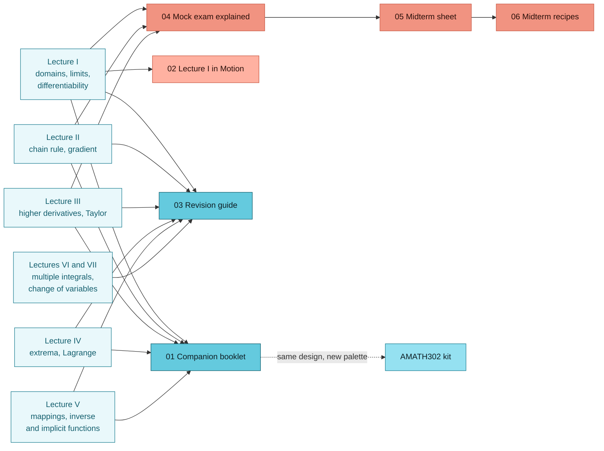
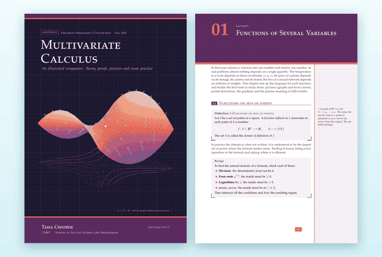
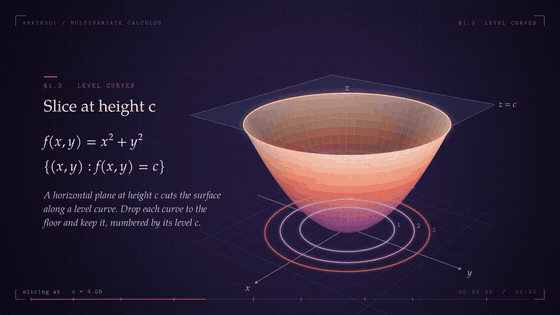
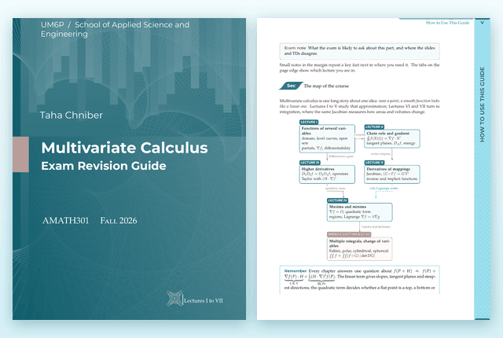
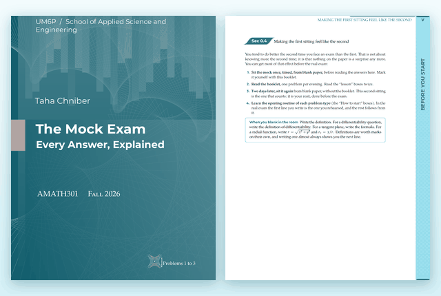
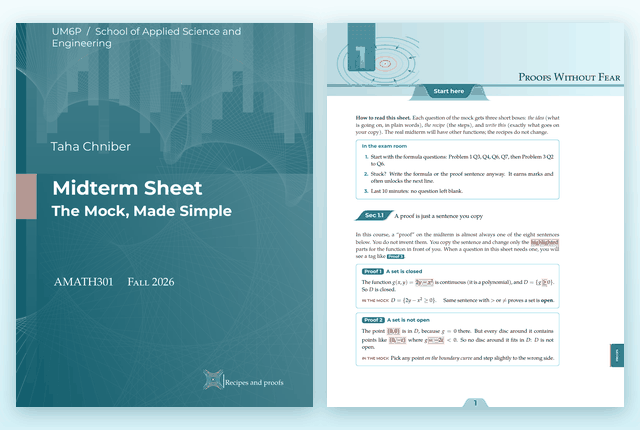
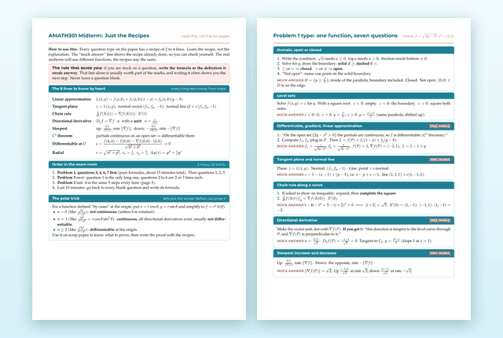

<div align="center">

<picture>
  <source media="(prefers-color-scheme: dark)" srcset="assets/banner-dark.svg">
  
</picture>

<br>


**[AMATH301](#amath301-multivariate-calculus)** · **[AMATH302](#amath302-introduction-to-optimization)** · **[Build](#build-it-yourself)** · **[Rework](#rework-it)** · **[Licences](#licences)**

</div>

---

Everything I made for my applied mathematics courses at **SASE, UM6P**: study booklets, a full
revision guide, exam walkthroughs, a midterm sheet, an animated lecture, and the prompts and
template kits behind them. Every project is LaTeX source that compiles on its own, with the
finished PDF next to it.

> Only my own material lives here. The course slides, TD sheets and exam papers belong to the
> teaching team and are not included.

## How it fits together



## AMATH301: Multivariate Calculus

<table>
<tr>
<td width="50%" valign="top">

### 01 · Companion booklet
<a href="AMATH301/01-companion-booklet/AMATH301_Multivariate_Calculus_Companion.pdf"></a>

The first booklet: Lectures I to V summarised chapter by chapter, worked examples, exam-style
questions with full solutions, and a formula sheet. Plum and coral palette, 3D surfaces drawn
in TikZ.

`95 pages` · `pdfLaTeX` · [PDF](AMATH301/01-companion-booklet/AMATH301_Multivariate_Calculus_Companion.pdf) · [source](AMATH301/01-companion-booklet/src)

</td>
<td width="50%" valign="top">

### 02 · Lecture I in Motion
<a href="AMATH301/02-lecture-I-in-motion/Lecture_I_in_Motion.html"></a>

A 1:34 animated explainer of Lecture I: domains, graphs, level curves, the saddle, limits.
Everything is drawn live on an HTML canvas by about 1,300 lines of JavaScript, with chapter
chips and a scrubbable timeline.

`1:34` · `HTML + JS` · [HTML page](AMATH301/02-lecture-I-in-motion/Lecture_I_in_Motion.html) (download, open in a browser) · [MP4](AMATH301/02-lecture-I-in-motion/AMATH301_Lecture1_in_Motion_light.mp4) · [source](AMATH301/02-lecture-I-in-motion/src)

</td>
</tr>
<tr>
<td width="50%" valign="top">

### 03 · Exam revision guide
<a href="AMATH301/03-revision-guide/AMATH301_Revision_Guide.pdf"></a>

The big one, Lectures I to VII. Theory with intuition, trap and real-life boxes, every TD
problem solved with a hint, extra exam-style problems, a toolkit (theorems with their
conditions, ten proofs to know, a traps table, a 16-question drill), two full mock exams with
marked solutions, an annexe for Lectures VI and VII, and a formula sheet.

`76 pages` · `XeLaTeX` · [PDF](AMATH301/03-revision-guide/AMATH301_Revision_Guide.pdf) · [source](AMATH301/03-revision-guide/src) · [checks](AMATH301/03-revision-guide/verification)

</td>
<td width="50%" valign="top">

### 04 · Mock exam, explained
<a href="AMATH301/04-mock-exam-explained/AMATH301_Mock_Exam_Explained.pdf"></a>

The mock exam taught one question at a time: the lesson behind it, how to start, the model
answer as you would write it, the traps, and a graph for every part. Ends with a two-sitting
tick sheet and what the marker looks for.

`44 pages` · `XeLaTeX` · [PDF](AMATH301/04-mock-exam-explained/AMATH301_Mock_Exam_Explained.pdf) · [source](AMATH301/04-mock-exam-explained/src) · [checks](AMATH301/04-mock-exam-explained/verification)

</td>
</tr>
<tr>
<td width="50%" valign="top">

### 05 · Midterm sheet
<a href="AMATH301/05-midterm-sheet/AMATH301_Midterm_Sheet.pdf"></a>

The short version for the night before. Eight proof sentences to copy (only the highlighted
parts change), then every mock question as *the idea*, *the recipe* and *write this*. One page
of what to remember.

`14 pages` · `XeLaTeX` · [PDF](AMATH301/05-midterm-sheet/AMATH301_Midterm_Sheet.pdf) · [source](AMATH301/05-midterm-sheet/src)

</td>
<td width="50%" valign="top">

### 06 · Midterm recipes
<a href="AMATH301/06-midterm-recipes/AMATH301_Midterm_Recipes.pdf"></a>

Four pages, one card per question type, the mock answer under each card, and the order to
tackle the paper in. The fastest thing to reread.

`4 pages` · `XeLaTeX` · [PDF](AMATH301/06-midterm-recipes/AMATH301_Midterm_Recipes.pdf) · [source](AMATH301/06-midterm-recipes/src)

</td>
</tr>
</table>

## AMATH302: Introduction to Optimization

[`AMATH302/kit`](AMATH302/kit) is the starter kit for the AMATH302 booklet: the companion
booklet's design with a new palette, an empty chapter to copy once per lecture, and
[`PROMPT.md`](AMATH302/kit/PROMPT.md), the prompt that builds the whole booklet from the
lecture slides. [`template-preview.pdf`](AMATH302/kit/template-preview.pdf) shows the empty kit.

## Prompts

[`prompts/revision-guide-prompt.md`](prompts/revision-guide-prompt.md) is the reusable prompt
behind the revision guide. Paste it into a new chat with another course's files to get the
same kind of guide for that course.

## Build it yourself

Every `src/` folder compiles on its own:

```bash
# 03, 04, 05, 06: XeLaTeX (Montserrat is bundled in src/fonts)
cd AMATH301/03-revision-guide/src
xelatex main.tex && xelatex main.tex && xelatex main.tex

# 01 and the AMATH302 kit: pdfLaTeX
cd AMATH301/01-companion-booklet/src
pdflatex main.tex && pdflatex main.tex && pdflatex main.tex
```

You need a recent TeX Live with `tcolorbox`, `pgfplots`, `tikz`, `scrlayer-scrpage`, `mathpazo`
and TeX Gyre Pagella. On **Overleaf**, upload one `src/` folder as a project and pick XeLaTeX or
pdfLaTeX in *Menu → Compiler*.

The animation and the README visuals:

```bash
cd AMATH301/02-lecture-I-in-motion/src
python3 build.py                 # rebuilds the playable page (dist/) and rec.html
python3 stills.py out 3 40 90    # JPG stills at chosen seconds (needs Playwright)

cd math-courses/assets
python3 make_banner.py           # animated SVG banners, light and dark
python3 make_previews.py         # page-flip GIFs of every PDF + the animation clip
```

## Rework it

| I want to… | Edit |
|---|---|
| change the colours of 03 to 05 | the `\definecolor` block at the top of `src/style.tex` |
| change the colours of 01 | `src/style.tex`, the `plum…` and `coral…` colours |
| change the cover | `\title`, `\subtitle`, `\edition` in `src/main.tex` (03 to 05), `src/cover.tex` (01) |
| add a chapter | a new `.tex` file and one `\input{...}` line in `src/main.tex` |
| add a box type | copy one `\newtcolorbox` in `src/style.tex` (look for `lesson`, `trap`, `idea`) |
| move a thumb tab | the `\settab{LABEL}{position}` line at the top of each chapter file |
| refresh the README previews | rebuild the PDF, then `python3 assets/make_previews.py` |

## Checking the maths

Every numerical answer was recomputed with SymPy before it went into a PDF. The scripts are in
the `verification/` folders. `boxcheck.py` checks that no box lost text in the compiled PDF:

```bash
cd AMATH301/04-mock-exam-explained/verification
python3 boxcheck.py ../src ../AMATH301_Mock_Exam_Explained.pdf front.tex p1.tex p2.tex p3.tex wrap.tex
```

<details>
<summary><b>Folder tree</b></summary>

```
math-courses/
├── README.md
├── assets/                     banners, GIF previews, and the scripts that make them
├── AMATH301/
│   ├── 01-companion-booklet/   PDF + src/ (pdfLaTeX)
│   ├── 02-lecture-I-in-motion/ playable HTML, MP4 + src/ (JS, Python)
│   ├── 03-revision-guide/      PDF + src/ (XeLaTeX) + verification/
│   ├── 04-mock-exam-explained/ PDF + src/ (XeLaTeX) + verification/
│   ├── 05-midterm-sheet/       PDF + src/ (XeLaTeX)
│   └── 06-midterm-recipes/     PDF + src/ (XeLaTeX)
├── AMATH302/kit/               template kit + PROMPT.md
├── prompts/                    revision-guide-prompt.md
└── licenses/                   beautybook (LPPL) and Montserrat (OFL)
```

</details>

## Licences

- **My notes, code and prompts:** MIT, like the rest of this repository.
- **`beautybook.cls`** and `stys/beautybook-cover-en.sty`: modified copies of
  [beautybook](https://ctan.org/pkg/beautybook) by Ethan Lu, LPPL 1.3c or later. The changes are
  listed at the top of each `beautybook.cls`; see [`licenses/beautybook-README.md`](licenses/beautybook-README.md).
- **Montserrat:** SIL Open Font License 1.1, see [`licenses/Montserrat-OFL.txt`](licenses/Montserrat-OFL.txt).
- **Animation web fonts:** converted from TeX Gyre Pagella and Latin Modern (GUST Font License).
